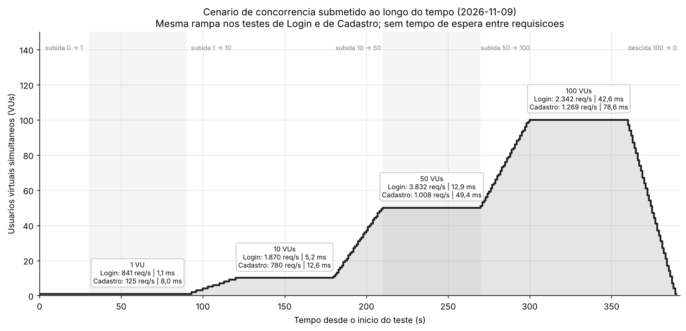
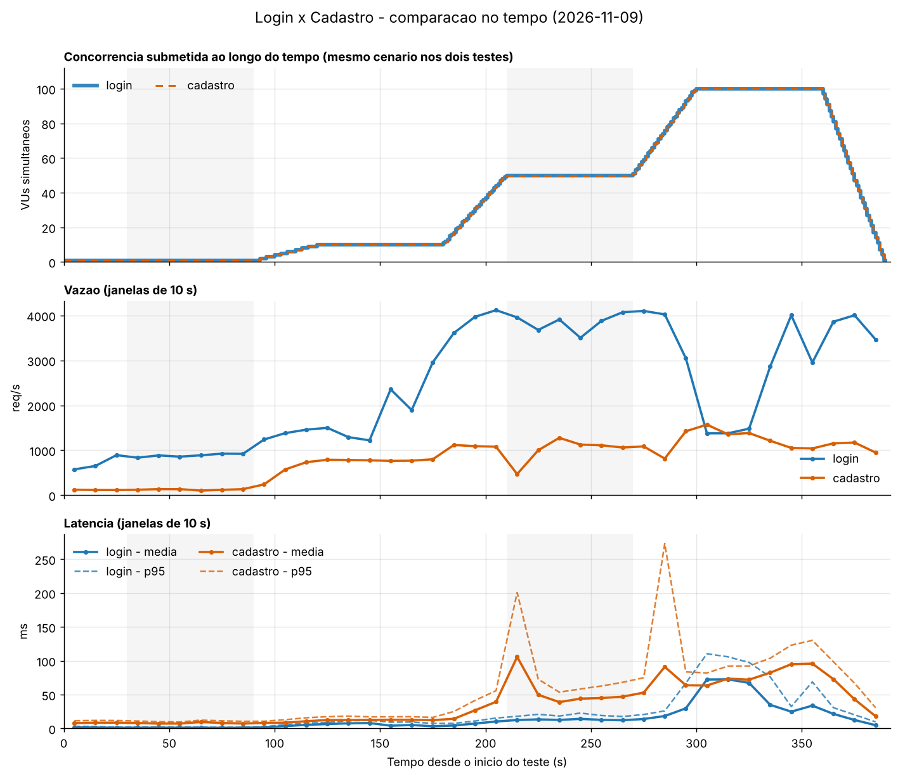
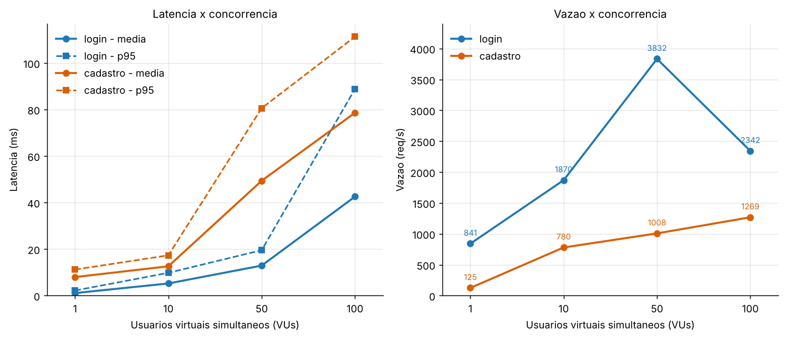

# 🐾 Adopets

Plataforma web de adoção de animais: anúncios de pets, chat entre usuários, pedidos de adoção, postagens, eventos e ONGs. O servidor é feito em **Node.js + Express**, os dados ficam em **MySQL** e o front-end é HTML/CSS/JavaScript servido pelo próprio Express.

Este repositório também contém a **entrega de Testes de Carga** (k6) dos serviços de **Login** e **Cadastro**, com gráficos e levantamento de hipóteses de gargalos.

---

## 📑 Entrega: Testes de Carga

> 👉 **Relatório completo: [RELATORIO.md](RELATORIO.md)**

Tudo o que compõe a entrega pode ser acessado a partir desta página:

| O quê | Onde |
|---|---|
| Relatório das medições (SLA, gráficos e hipóteses de gargalos) | [RELATORIO.md](RELATORIO.md) |
| Seção do Login (leitura) | [RELATORIO.md#3-serviço-1--login](RELATORIO.md#3-serviço-1--login) |
| Seção do Cadastro (escrita) | [RELATORIO.md#4-serviço-2--cadastro](RELATORIO.md#4-serviço-2--cadastro) |
| Comparação entre os serviços | [RELATORIO.md#5-comparação-entre-os-serviços](RELATORIO.md#5-comparação-entre-os-serviços) |
| Hipóteses de gargalos do Login | [RELATORIO.md#34-levantamento-de-hipóteses-dos-gargalos-login](RELATORIO.md#34-levantamento-de-hipóteses-dos-gargalos-login) |
| Hipóteses de gargalos do Cadastro | [RELATORIO.md#44-levantamento-de-hipóteses-dos-gargalos-cadastro](RELATORIO.md#44-levantamento-de-hipóteses-dos-gargalos-cadastro) |
| Quadro-resumo das hipóteses | [RELATORIO.md#6-levantamento-de-hipóteses-dos-gargalos](RELATORIO.md#6-levantamento-de-hipóteses-dos-gargalos) |
| Script k6 do Login | [testes-de-carga/login.js](testes-de-carga/login.js) |
| Script k6 do Cadastro | [testes-de-carga/cadastro.js](testes-de-carga/cadastro.js) |
| Agregação do JSON bruto por janelas de 1 s, 5 s e 10 s | [testes-de-carga/analisar.js](testes-de-carga/analisar.js) |
| Geração dos gráficos | [testes-de-carga/gerar_graficos.py](testes-de-carga/gerar_graficos.py) |
| Ambiente da medição (máquina, versões, configuração) | [testes-de-carga/resultados/ambiente.md](testes-de-carga/resultados/ambiente.md) |
| Resultados do k6 (09/11/2026) | [resumo do Login](testes-de-carga/resultados/2026-11-09/login-resumo.json) · [resumo do Cadastro](testes-de-carga/resultados/2026-11-09/cadastro-resumo.json) |
| Dados agregados por janela (base dos gráficos) | [Login](testes-de-carga/resultados/2026-11-09/login-agregado.json) · [Cadastro](testes-de-carga/resultados/2026-11-09/cadastro-agregado.json) |

### 📈 Gráficos

| Gráfico | Arquivo |
|---|---|
| Login: **concorrência**, vazão e latência no tempo | [login_evolucao.png](testes-de-carga/graficos/2026-11-09/login_evolucao.png) |
| Cadastro: **concorrência**, vazão e latência no tempo | [cadastro_evolucao.png](testes-de-carga/graficos/2026-11-09/cadastro_evolucao.png) |
| **Cenário de concorrência submetido ao longo do tempo** (com o resultado de cada patamar) | [concorrencia_cenario.png](testes-de-carga/graficos/2026-11-09/concorrencia_cenario.png) |
| Comparação: latência e vazão por nível de concorrência | [comparacao_por_vus.png](testes-de-carga/graficos/2026-11-09/comparacao_por_vus.png) |
| Comparação: **concorrência**, vazão e latência dos dois serviços sobrepostos no tempo | [comparacao_evolucao.png](testes-de-carga/graficos/2026-11-09/comparacao_evolucao.png) |
| Comparação: indicadores globais | [comparacao_resumo.png](testes-de-carga/graficos/2026-11-09/comparacao_resumo.png) |

**Cenário de concorrência submetido ao longo do tempo** (o mesmo nos dois testes):



**Concorrência, vazão e latência ao longo do tempo** (Login x Cadastro):



**Latência e vazão por nível de concorrência:**



### 🔎 Resumo dos resultados (09/11/2026)

Rampa de 1 → 10 → 50 → 100 usuários virtuais, sem tempo de espera, durante 390 s, com k6, servidor e MySQL na mesma máquina.

| | Login (leitura) | Cadastro (escrita) |
|---|---:|---:|
| Requisições | 939.635 | 308.809 |
| Vazão média | 2.409 req/s | 792 req/s |
| Latência média / p95 | 15,29 ms / 56,54 ms | 46,69 ms / 96,61 ms |
| Erros | 0 % | 0 % |
| Saturação da vazão | ≈ 50 VUs | entre 10 e 50 VUs |

Os dois serviços atenderam ao limite de exemplo (`p95 < 1000 ms` e `erros < 1 %`). Detalhes, gráficos e hipóteses de gargalo estão no [RELATORIO.md](RELATORIO.md).

### 🧠 Hipóteses de gargalos

Cada hipótese está detalhada, com evidência nos dados e experimento de validação, em [Login (3.4)](RELATORIO.md#34-levantamento-de-hipóteses-dos-gargalos-login) e [Cadastro (4.4)](RELATORIO.md#44-levantamento-de-hipóteses-dos-gargalos-cadastro). Resumo:

| ID | Serviço | Hipótese de gargalo |
|---|---|---|
| L1 | Login | CPU do Node (thread única) como teto de vazão (≈ 4.100 req/s a partir de 50 VUs) |
| L2 | Login | Fila no pool de 10 conexões do MySQL |
| L3 | Login | Instabilidade ambiental no patamar de 100 VUs (vazão cai de ≈ 4.000 para ≈ 1.400 req/s por ≈ 35 s) |
| L4 | Login | Custo de autenticação irrealisticamente baixo: senha comparada em texto puro, sem hash |
| C1 | Cadastro | Custo da escrita durável (commit no InnoDB): ≈ 8 ms por requisição com 1 VU |
| C2 | Cadastro | Manutenção de 3 índices e crescimento da tabela (vazão cai de ≈ 1.570 para ≈ 1.040 req/s no patamar de 100 VUs) |
| C3 | Cadastro | Paradas curtas de 3–4 s em t ≈ 212 s e t ≈ 282 s |
| C4 | Cadastro | Fila no pool, com duas consultas por requisição |

---

## 📦 Estrutura do Projeto

```plaintext
.
├── server.js                      # Servidor Express: rotas da API e inicialização do banco
├── package.json                   # Dependências do Node
├── B.arquivo.env                  # Modelo das variáveis de ambiente (copie para .env)
├── mysql/
│   └── Adopetz.sql                # Criação e carga inicial do banco "adopetz"
├── public/                        # Front-end (HTML, CSS, JS, imagens)
├── README.md                      # Este arquivo
├── RELATORIO.md                   # Relatório dos testes de carga
└── testes-de-carga/
    ├── login.js                   # Teste k6: POST /api/login
    ├── cadastro.js                # Teste k6: POST /api/register
    ├── analisar.js                # Reduz o JSON bruto do k6 a janelas de 1 s, 5 s e 10 s
    ├── gerar_graficos.py          # Gera os gráficos a partir dos dados agregados
    ├── graficos/
    │   └── 2026-11-09/            # Gráficos (PNG) da medição
    └── resultados/
        ├── ambiente.md            # Máquina, versões e configuração da medição
        └── 2026-11-09/            # Resumos do k6 e dados agregados (JSON)
```

---

## 🚀 Execução local

1. **Clone o repositório:**

   ```bash
   git clone https://github.com/jotinhakkk/Adopets
   cd Adopets
   ```

2. **Instale as dependências:**

   ```bash
   npm install
   ```

3. **Configure o banco de dados MySQL.** Copie `B.arquivo.env` para `.env` e preencha as credenciais (`DB_HOST`, `DB_PORT`, `DB_USER`, `DB_PASSWORD`, `DB_NAME`, `PORT` e `SESSION_SECRET`). Com o MySQL em execução, o servidor cria e popula o banco `adopetz` automaticamente na primeira inicialização, a partir de `mysql/Adopetz.sql`.


4. **Inicie o servidor:**

   ```bash
   node server.js
   ```

5. **Acesse no navegador:** 🔗 **http://localhost:3000**

---

## 🧪 Como reproduzir os testes de carga

Pré-requisitos: [k6](https://k6.io/docs/getting-started/installation/) e Node.js instalados, MySQL em execução e o servidor rodando (`node server.js`). O teste de Login precisa de um usuário já cadastrado.

Execute a partir da pasta `testes-de-carga/` e crie antes a pasta do dia (por exemplo, `resultados/2026-11-09`):

```bash
cd testes-de-carga

# Login
k6 run -e LOGIN_EMAIL=karenzinha@email.com -e LOGIN_SENHA=senha123 --summary-export=resultados/2026-11-09/login-resumo.json --out json=resultados/2026-11-09/login.json login.js

# Cadastro
k6 run --summary-export=resultados/2026-11-09/cadastro-resumo.json --out json=resultados/2026-11-09/cadastro.json cadastro.js

# Agregação do JSON bruto (vários GB, não versionado)
node analisar.js resultados/2026-11-09/login.json
node analisar.js resultados/2026-11-09/cadastro.json

# Gráficos em graficos/2026-11-09/
pip install matplotlib
python gerar_graficos.py 2026-11-09
```

O teste de cadastro insere cerca de 300 mil usuários de teste. A limpeza está descrita na [seção 8 do relatório](RELATORIO.md#8-como-reproduzir).

---

## 🛠️ Tecnologias utilizadas

- Node.js, Express, express-session, multer
- MySQL (driver `mysql2`)
- HTML, CSS e JavaScript no front-end
- k6 para os testes de carga
- Node.js (agregação) e Python com matplotlib (gráficos)