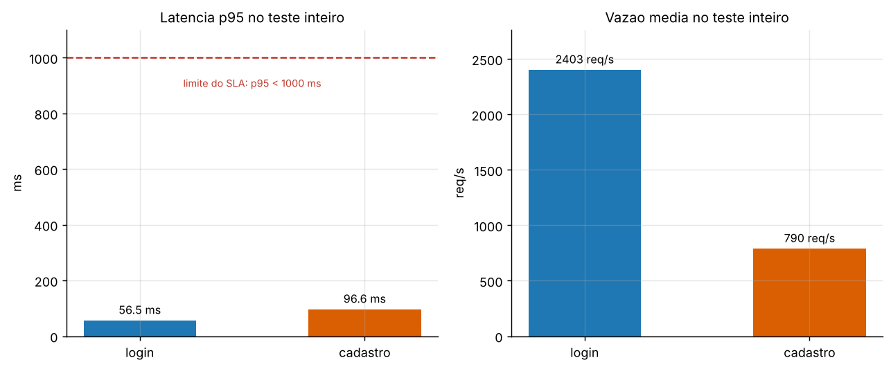
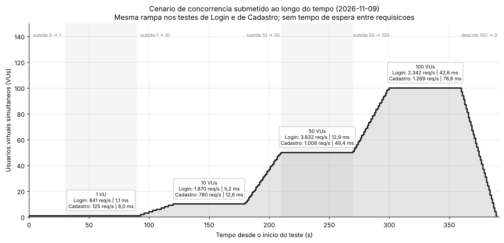
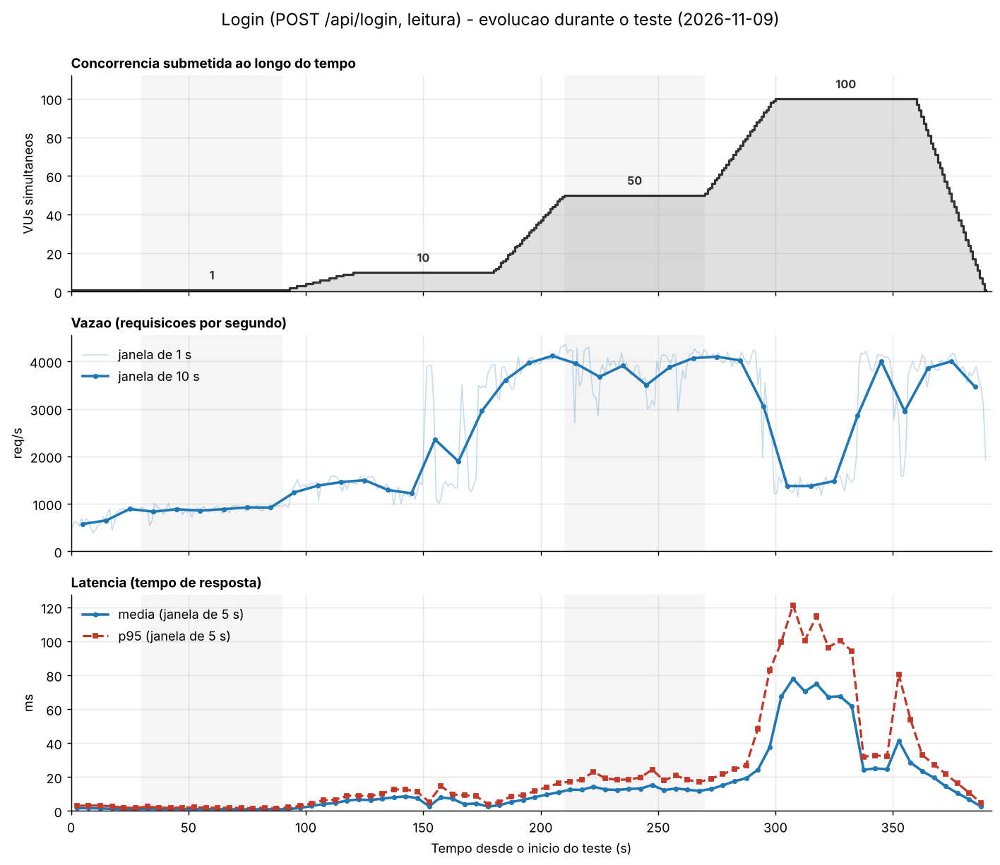
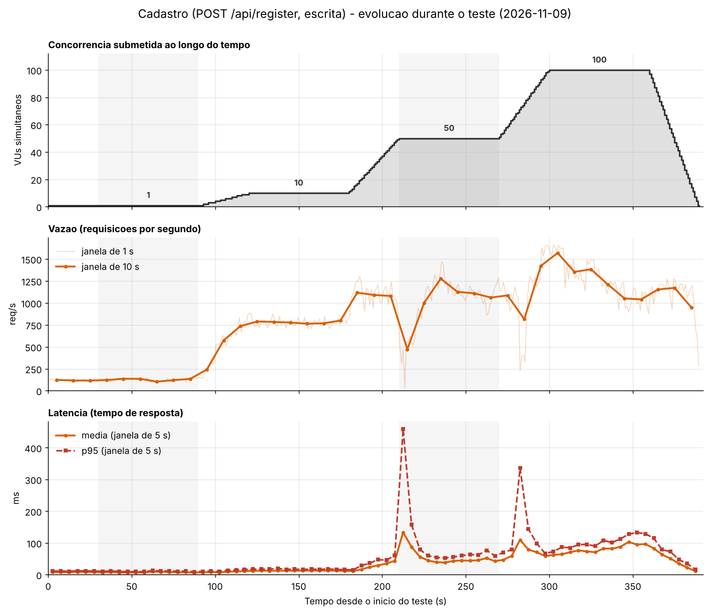
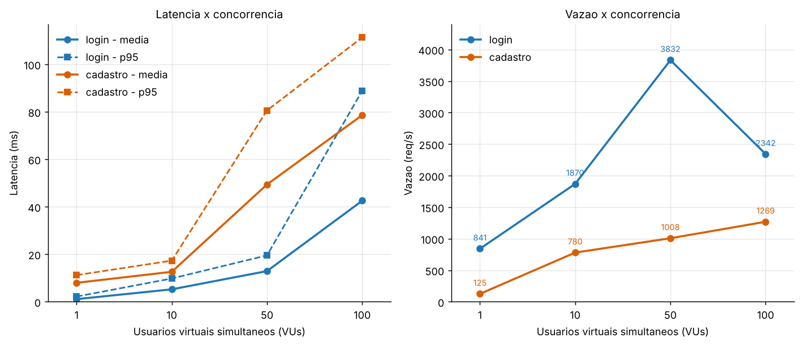
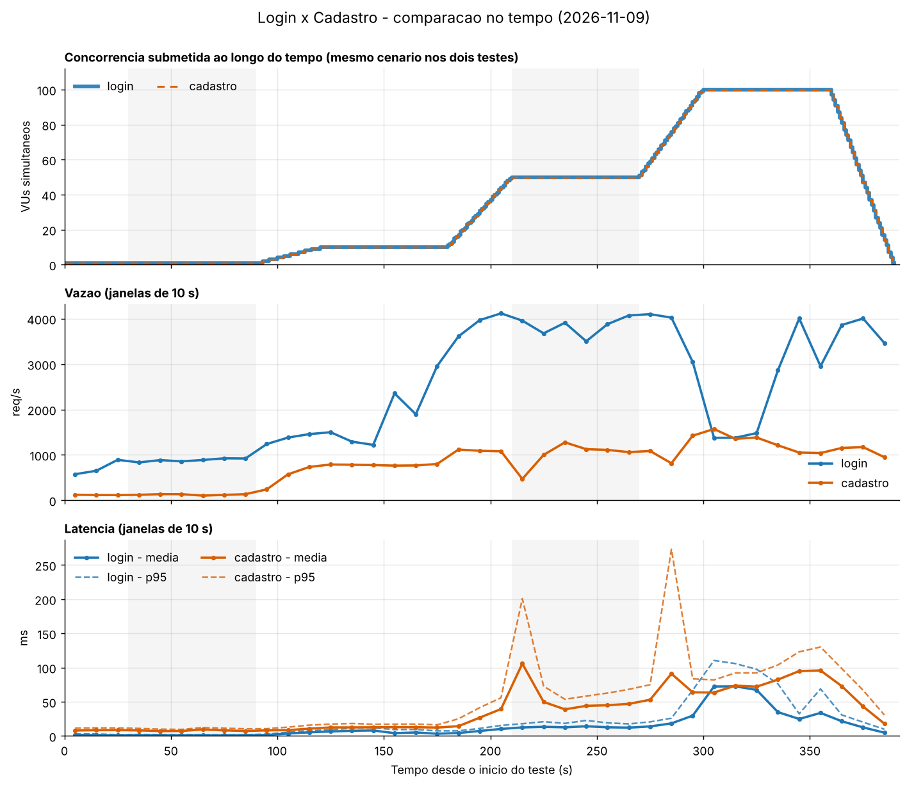

# 📊 Relatório de Testes de Carga — Adopets

Medição de **latência**, **vazão** e **concorrência** dos dois serviços do Adopets que acessam o banco de dados: **Login** (leitura) e **Cadastro** (escrita). Ferramenta: [k6](https://k6.io/). Data da medição: **09/11/2026**.

> 🔙 Voltar para o [README](README.md)

## Sumário

1. [Resumo executivo](#1-resumo-executivo)
2. [Metodologia e ambiente](#2-metodologia-e-ambiente)
3. [Serviço 1 — Login](#3-serviço-1--login)
4. [Serviço 2 — Cadastro](#4-serviço-2--cadastro)
5. [Comparação entre os serviços](#5-comparação-entre-os-serviços)
6. [Levantamento de hipóteses dos gargalos](#6-levantamento-de-hipóteses-dos-gargalos)
7. [Limitações da medição](#7-limitações-da-medição)
8. [Como reproduzir](#8-como-reproduzir)
9. [Ferramentas e links úteis](#9-ferramentas-e-links-úteis)

---

## 1. Resumo executivo

Cada serviço recebeu uma rampa de **1 → 10 → 50 → 100 usuários virtuais (VUs)**, sem tempo de espera entre requisições, durante 6 min 30 s (390 s).

| Indicador (teste inteiro) | Login | Cadastro |
|---|---:|---:|
| Requisições | 939.635 | 308.809 |
| Vazão média | 2.409 req/s | 792 req/s |
| Pico de vazão (janela de 10 s) | 4.117 req/s (50 VUs) | 1.570 req/s (100 VUs) |
| Latência média | 15,29 ms | 46,69 ms |
| Latência mediana | 11,06 ms | 43,70 ms |
| Latência p95 | 56,54 ms | 96,61 ms |
| Latência máxima | 345,18 ms | 1.149,86 ms |
| Erros (`http_req_failed`) | 0 % | 0 % |
| Checks (200 / 201) | 100 % | 100 % |
| Limite do SLA de exemplo (`p95 < 1000 ms` e `erros < 1 %`) | ✅ atendido | ✅ atendido |

> Observação: a vazão acima é a informada pelo k6 (total ÷ 390 s). Os gráficos e as tabelas por janela usam a duração medida pelo `analisar.js` (391 s), por isso o gráfico de barras mostra 2.403 e 790 req/s. A diferença é só de arredondamento do tempo.

**Principais conclusões**

1. **Os dois serviços atendem o SLA de exemplo com folga** até 100 usuários simultâneos: 0 erros em ≈ 1,25 milhão de requisições e p95 bem abaixo de 1 s.
2. **O ponto de saturação da vazão é diferente.** O Login satura por volta de **50 VUs** (≈ 3.800–4.100 req/s). O Cadastro satura antes, entre **10 e 50 VUs** (780 → 1.008 req/s), chegando a ≈ 1.270 req/s com 100 VUs.
3. **Escrever custa mais que ler:** com 1 VU o Cadastro leva ≈ 8 ms por requisição contra ≈ 1,1 ms do Login, e a vazão máxima do Cadastro é cerca de 3× menor.
4. **Depois de saturar, a latência cresce na mesma proporção dos VUs**, sem gerar erros (efeito de fila; ver [Lei de Little](#53-verificação-de-consistência-lei-de-little)).
5. **Dois comportamentos instáveis merecem investigação:** a queda temporária de vazão do Login no patamar de 100 VUs e as paradas curtas (≈ 3–4 s) do Cadastro. Ambos têm hipóteses nas seções [3.4](#34-levantamento-de-hipóteses-dos-gargalos-login) (Login) e [4.4](#44-levantamento-de-hipóteses-dos-gargalos-cadastro) (Cadastro), resumidas na [seção 6](#6-levantamento-de-hipóteses-dos-gargalos).
6. ⚠️ **O Login atual compara a senha em texto puro** (sem hash). Os números do Login valem para essa implementação e tendem a ser otimistas em relação a uma versão segura (hipótese L4).



---

## 2. Metodologia e ambiente

### 2.1 Descrição das configurações (máquinas/containers)

Não foram usados containers: servidor, banco e gerador de carga rodaram diretamente no mesmo PC (detalhes originais em [`ambiente.md`](testes-de-carga/resultados/ambiente.md)).

| Item | Valor |
|---|---|
| Máquina | PC, CPU Intel i5-13400, 32 GB de RAM, Windows |
| Servidor | Node.js v24.22.0 + Express (porta 3000) |
| Banco de dados | MySQL 8.4.7, local (banco `adopetz`) |
| Pool de conexões do servidor | 10 (`connectionLimit: 10`, ver [server.js](server.js#L13-L22)) |
| Usuários no banco antes do teste | 3 |
| Gerador de carga | k6 v2.3.0 (windows/amd64), **na mesma máquina do servidor** |
| Rede | Ethernet (as requisições foram para `localhost`) |

### 2.2 Perfil de carga (igual nos dois serviços)

Definido em [`login.js`](testes-de-carga/login.js) e [`cadastro.js`](testes-de-carga/cadastro.js) (variável `STAGES`, padrão `1,10,50,100`). Cada degrau sobe em 30 s e se mantém por 1 min; no fim, desce a 0 em 30 s.

| Tempo (s) | Fase | VUs |
|---|---|---:|
| 0–30 | subida | 0 → 1 |
| 30–90 | patamar | 1 |
| 90–120 | subida | 1 → 10 |
| 120–180 | patamar | 10 |
| 180–210 | subida | 10 → 50 |
| 210–270 | patamar | 50 |
| 270–300 | subida | 50 → 100 |
| 300–360 | patamar | 100 |
| 360–390 | descida | 100 → 0 |

**Cenário de concorrência submetido ao longo do tempo** (o mesmo nos dois testes; sobre cada patamar estão os resultados medidos):



- **Sem tempo de espera** (`THINK_TIME=0`): cada VU dispara a próxima requisição assim que recebe a resposta. Isso mede a capacidade máxima do serviço, não o uso de pessoas reais.
- **Limites (thresholds) usados como SLA de exemplo:** `http_req_failed < 1 %` e `http_req_duration p(95) < 1000 ms`.

### 2.3 Como as métricas foram obtidas

| Métrica | Definição | Fonte |
|---|---|---|
| **Latência** | tempo de resposta da requisição (`http_req_duration`): média, mediana, p90, p95 e máximo | k6 (`--summary-export`) e janelas do `analisar.js` |
| **Vazão** | requisições por segundo, calculada em janelas de **1 s, 5 s e 10 s** e também por patamar | [`analisar.js`](testes-de-carga/analisar.js) |
| **Concorrência** | número de VUs simultâneos (`vus`), que equivale ao número de requisições em andamento, pois não há tempo de espera | k6 |

Fluxo de dados: `k6 run` gera o JSON bruto (vários GB, não versionado) → `analisar.js` reduz a poucos KB (`*-agregado.json`) → [`gerar_graficos.py`](testes-de-carga/gerar_graficos.py) produz os gráficos desta página.

---

## 3. Serviço 1 — Login

| Item | Descrição |
|---|---|
| **Endpoint** | `POST /api/login` |
| **Tipo de operação** | **Leitura** (`SELECT` na tabela `usuario` por e-mail e senha; se não achar, consulta também `administrador`). Também grava a sessão em memória. |
| **Data da medição** | 09/11/2026 (início às 02:45:06, fuso −03:00) |

### 3.1 Arquivos envolvidos

- [`server.js` — rota `POST /api/login` (linhas 87–104)](server.js#L87-L104)
- [`server.js` — pool de conexões MySQL (linhas 13–22)](server.js#L13-L22) e [sessão em memória (linhas 37–41)](server.js#L37-L41)
- [`public/login.html`](public/login.html) — formulário que chama `/api/login`
- [`mysql/Adopetz.sql` — tabela `usuario` (linhas 32–46)](mysql/Adopetz.sql#L32-L46), com índice `UNIQUE` em `email` e em `cpf`

### 3.2 Arquivos com o código-fonte da medição

- [`testes-de-carga/login.js`](testes-de-carga/login.js) — script k6
- [`testes-de-carga/analisar.js`](testes-de-carga/analisar.js) — agregação por janelas
- [`testes-de-carga/gerar_graficos.py`](testes-de-carga/gerar_graficos.py) — gráficos
- Resultados: [`login-resumo.json`](testes-de-carga/resultados/2026-11-09/login-resumo.json) (k6) e [`login-agregado.json`](testes-de-carga/resultados/2026-11-09/login-agregado.json) (janelas)

### 3.3 Resultados (SLA observado)

**Por nível de concorrência** (segundos em que havia exatamente N VUs ativos):

| VUs | Vazão (req/s) | Latência média (ms) | p95 (ms) | Máxima (ms) | Erros |
|---:|---:|---:|---:|---:|---:|
| 1 | 841,3 | 1,11 | 2,20 | 17,59 | 0 % |
| 10 | 1.869,7 | 5,24 | 9,81 | 69,86 | 0 % |
| 50 | 3.832,2 | 12,92 | 19,55 | 345,18 | 0 % |
| 100 | 2.342,2 | 42,57 | 88,87 | 341,54 | 0 % |

> A linha de 1 VU inclui os 94 s iniciais; as demais, 60 s cada.

**Evolução no tempo.** O painel superior mostra a **concorrência submetida** (VUs simultâneos); o do meio, a **vazão** (janelas de 1 s e 10 s); o inferior, a **latência** (janelas de 5 s). Os três compartilham o mesmo eixo de tempo:



**Concorrência (limite de requisições simultâneas).** O cenário submetido foi a rampa 1 → 10 → 50 → 100 VUs (gráfico da [seção 2.2](#22-perfil-de-carga-igual-nos-dois-serviços) e painel superior acima). Como não há tempo de espera, cada VU mantém uma requisição em andamento, então **100 VUs ≈ 100 requisições simultâneas**. O máximo testado foi 100 simultâneas e **o limite de falha não foi atingido**: 0 % de erro e p95 de 88,87 ms nesse patamar. O que saturou foi a vazão, por volta de **50 VUs** (≈ 3.800–4.100 req/s).

**Leitura dos resultados**

- A vazão sobe junto com os VUs até **≈ 4.100 req/s com 50 VUs** (pico de 4.353 req/s em uma janela de 1 s) e não passa disso.
- **No patamar de 100 VUs a vazão não se mantém:** nos primeiros 30 s (t = 300–330 s) ela cai para ≈ 1.410 req/s com latência média de 71 ms; nos 30 s seguintes (t = 330–360 s) volta para ≈ 3.270 req/s e 35 ms. Não houve nenhum erro. Por isso a média do patamar (2.342 req/s) esconde **dois regimes** diferentes.
- O maior pico de latência (345 ms) ocorreu no início do patamar de 50 VUs (t ≈ 210 s); no patamar de 100 VUs o máximo foi de 342 ms, justamente no início da queda de vazão descrita acima.

### 3.4 Levantamento de hipóteses dos gargalos (Login)

Estas são **hipóteses**: as medições mostram *o que* aconteceu, mas não monitoraram CPU, memória e estado do MySQL durante o teste. Cada item traz a evidência encontrada e um experimento para confirmar ou descartar.

**L1 — CPU do Node (processo de thread única) como teto de vazão.**
- *Evidência:* a vazão para de crescer em ≈ 4.100 req/s a partir de 50 VUs, embora a consulta seja trivial (busca pelo índice `UNIQUE` de `email` numa tabela de 3 linhas) e, com 1 VU, a latência seja de apenas 1,1 ms.
- *Como validar:* observar o processo `node` durante o teste (um núcleo próximo de 100 % é a assinatura desse gargalo) ou subir duas instâncias (`cluster`/PM2) e verificar se a vazão máxima quase dobra.

**L2 — Fila no pool de 10 conexões do MySQL.**
- *Evidência:* com 100 VUs há até 90 requisições esperando conexão (`waitForConnections: true`, sem limite de fila), e a latência cresce na proporção dos VUs. Porém, com 50 VUs já havia 40 requisições na fila sem queda de vazão, então o pool **sozinho não explica** a perda a 100 VUs.
- *Como validar:* repetir o teste com `connectionLimit` de 10, 25 e 50 e comparar o p95 em 100 VUs.

**L3 — Instabilidade ambiental no patamar de 100 VUs** (vazão cai de ≈ 4.000 para ≈ 1.400 req/s por ≈ 35 s e volta sozinha, sem erros e com carga constante).
- *Hipóteses:* k6, Node e MySQL disputando CPU na mesma máquina (o i5-13400 mistura núcleos de desempenho e de eficiência), pausa de coleta de lixo (GC) do Node ou escalonamento do Windows. Uma falha de lógica da aplicação seria menos provável, pois o comportamento se desfaz sem mudança de carga.
- *Como validar:* repetir o teste pelo menos 3 vezes (se a queda mudar de horário ou sumir, é ambiental), rodar o k6 em outra máquina e iniciar o Node com `--trace-gc`.

**L4 — Custo de autenticação irrealisticamente baixo.**
- *Evidência no código:* o `SELECT` compara `senha` em texto puro (`WHERE email = ? AND senha = ?`) e o `bcrypt`, embora esteja no `package.json`, **não é usado** no `server.js`.
- *Impacto esperado (estimativa, não medida):* com hash de senha, cada login passaria a gastar CPU na verificação e o gargalo mudaria para esse cálculo; a vazão máxima provavelmente seria ordens de grandeza menor.
- *Como validar:* implementar a verificação com hash e repetir `login.js`.

---

## 4. Serviço 2 — Cadastro

| Item | Descrição |
|---|---|
| **Endpoint** | `POST /api/register` |
| **Tipo de operação** | **Inserção** (um `SELECT` para verificar e-mail/CPF duplicados, seguido de um `INSERT` em `usuario`) |
| **Data da medição** | 09/11/2026 (início às 02:58:50, fuso −03:00) |

### 4.1 Arquivos envolvidos

- [`server.js` — rota `POST /api/register` (linhas 106–122)](server.js#L106-L122)
- [`server.js` — pool de conexões MySQL (linhas 13–22)](server.js#L13-L22)
- [`public/register.html`](public/register.html) — formulário que chama `/api/register`
- [`mysql/Adopetz.sql` — tabela `usuario` (linhas 32–46)](mysql/Adopetz.sql#L32-L46): chave primária mais dois índices `UNIQUE` (`email` e `cpf`)

### 4.2 Arquivos com o código-fonte da medição

- [`testes-de-carga/cadastro.js`](testes-de-carga/cadastro.js) — script k6. Gera e-mail e CPF **únicos** a cada iteração (o servidor responde `409` se qualquer um repetir; sem isso o teste mediria apenas o erro).
- [`testes-de-carga/analisar.js`](testes-de-carga/analisar.js) e [`testes-de-carga/gerar_graficos.py`](testes-de-carga/gerar_graficos.py)
- Resultados: [`cadastro-resumo.json`](testes-de-carga/resultados/2026-11-09/cadastro-resumo.json) (k6) e [`cadastro-agregado.json`](testes-de-carga/resultados/2026-11-09/cadastro-agregado.json) (janelas)

### 4.3 Resultados (SLA observado)

**Por nível de concorrência:**

| VUs | Vazão (req/s) | Latência média (ms) | p95 (ms) | Máxima (ms) | Erros |
|---:|---:|---:|---:|---:|---:|
| 1 | 125,4 | 7,99 | 11,22 | 43,23 | 0 % |
| 10 | 780,1 | 12,62 | 17,33 | 65,15 | 0 % |
| 50 | 1.007,6 | 49,40 | 80,60 | 1.149,86 | 0 % |
| 100 | 1.268,6 | 78,62 | 111,34 | 242,60 | 0 % |

**Evolução no tempo.** Painel superior: concorrência submetida (VUs simultâneos); meio: vazão; inferior: latência. Mesmo eixo de tempo nos três:



**Concorrência (limite de requisições simultâneas).** Mesmo cenário do Login: rampa 1 → 10 → 50 → 100 VUs (gráfico da [seção 2.2](#22-perfil-de-carga-igual-nos-dois-serviços) e painel superior acima), ou seja, **até ≈ 100 requisições simultâneas**. O limite de falha também não foi atingido: 0 % de erro e p95 de 111,34 ms com 100 VUs. A vazão satura bem antes, **entre 10 e 50 VUs** (780 → 1.008 req/s), e chega a ≈ 1.270 req/s com 100 VUs.

**Leitura dos resultados**

- Com 1 VU cada requisição leva ≈ 8 ms. Com 10 VUs a vazão é 6,2× maior; a partir daí ela cresce pouco: **+29 % de 10 para 50 VUs e +26 % de 50 para 100 VUs**, enquanto a latência média sobe de 12,6 ms para 49,4 ms e 78,6 ms.
- **No patamar de 100 VUs a vazão cai com a carga constante:** de ≈ 1.570 req/s (t = 300 s) para ≈ 1.040 req/s (t = 350 s), e a latência média sobe de 63 ms para 96 ms.
- **Duas paradas curtas, sem erros:**
  - t ≈ 211–214 s (50 VUs): a vazão chegou a **25 req/s** em um segundo e a latência máxima foi de **1.150 ms**.
  - t ≈ 282–285 s (71–76 VUs): vazão de 226–404 req/s e latência máxima de 839 ms.
- O teste inseriu **≈ 308.800 usuários** na tabela `usuario` (veja como limpar na [seção 8](#8-como-reproduzir)).

### 4.4 Levantamento de hipóteses dos gargalos (Cadastro)

Estas são **hipóteses**: as medições mostram *o que* aconteceu, mas não monitoraram CPU, memória e estado do MySQL durante o teste. Cada item traz a evidência encontrada e um experimento para confirmar ou descartar.

**C1 — Custo da escrita durável (gravação do log de transações do InnoDB a cada `COMMIT`).**
- *Evidência:* com 1 VU o Cadastro leva ≈ 8 ms por requisição contra ≈ 1,1 ms do Login (≈ 7 ms a mais por `SELECT` + `INSERT`). A vazão com 10 VUs é 6,2× a de 1 VU (confirmações de transações agrupadas) e depois satura em ≈ 1.000–1.300 req/s.
- *Como validar:* verificar o valor de `innodb_flush_log_at_trx_commit` (1 = padrão, grava a cada commit); como experimento *apenas de diagnóstico*, repetir com o valor 2 e comparar. Acompanhar `Innodb_os_log_fsyncs` em `SHOW GLOBAL STATUS`.

**C2 — Manutenção de três índices e crescimento da tabela.**
- *Evidência:* cada `INSERT` atualiza a chave primária e os dois índices `UNIQUE` (`email` e `cpf`). No patamar de 100 VUs, com carga constante, a vazão cai de ≈ 1.570 para ≈ 1.040 req/s e a latência sobe de 63 ms para 96 ms enquanto a tabela cresce (≈ 308.800 linhas ao final).
- *Como validar:* repetir o teste com a tabela já populada e vazia e comparar; olhar `SHOW ENGINE INNODB STATUS` durante o patamar de 100 VUs.

**C3 — Paradas curtas (3–4 s) em t ≈ 212 s e t ≈ 282 s.**
- *Evidência:* vazão a 25 req/s e latência máxima de 1.150 ms (50 VUs); depois 226–404 req/s e 839 ms. Os dois eventos estão ≈ 70 s distantes, mas **dois pontos não provam periodicidade**.
- *Hipóteses:* descarga em rajada de páginas/log do InnoDB (checkpoint), pausa de GC do Node ou outro processo do Windows.
- *Como validar:* ativar o *slow query log* (`long_query_time = 0.2`), acompanhar `Innodb_buffer_pool_pages_flushed` e rodar o Node com `--trace-gc`; repetir e ver se as paradas reaparecem nos mesmos instantes.

**C4 — Fila no pool de 10 conexões, com duas passagens por requisição.**
- *Evidência:* a requisição faz duas chamadas separadas a `pool.query` (verificação de duplicidade e `INSERT`), sem transação. Com 100 VUs, 100 requisições disputam 10 conexões e cada uma entra na fila duas vezes; a latência cresce na proporção dos VUs.
- *Como validar:* variar o `connectionLimit` (como em L2) e testar uma versão que faça só o `INSERT`, tratando o erro de duplicidade (`ER_DUP_ENTRY`) com a resposta `409`. Isso elimina uma ida ao banco por requisição e também a janela de corrida entre a verificação e a inserção.

---

## 5. Comparação entre os serviços

### 5.1 Por nível de concorrência



> O eixo X é categórico (1, 10, 50 e 100 VUs igualmente espaçados).

| VUs | Vazão Login | Vazão Cadastro | Média Login | Média Cadastro | p95 Login | p95 Cadastro |
|---:|---:|---:|---:|---:|---:|---:|
| 1 | 841,3 | 125,4 | 1,11 ms | 7,99 ms | 2,20 ms | 11,22 ms |
| 10 | 1.869,7 | 780,1 | 5,24 ms | 12,62 ms | 9,81 ms | 17,33 ms |
| 50 | 3.832,2 | 1.007,6 | 12,92 ms | 49,40 ms | 19,55 ms | 80,60 ms |
| 100 | 2.342,2 | 1.268,6 | 42,57 ms | 78,62 ms | 88,87 ms | 111,34 ms |

### 5.2 Ao longo do tempo

Como os dois testes usam o mesmo cenário de concorrência, as curvas podem ser sobrepostas. O painel superior é a concorrência submetida (idêntica nos dois testes); os demais, a vazão e a latência (janelas de 10 s):



- O Login responde mais rápido e com mais vazão em todos os degraus, mas **é o único que perde vazão ao subir de 50 para 100 VUs** (ver seção 3.3).
- O Cadastro degrada de forma mais gradual, porém com as duas paradas curtas e a queda de vazão dentro do patamar de 100 VUs.
- No patamar de 100 VUs os dois serviços ficam com latência média próxima (43 ms contra 79 ms), mesmo com uma diferença de vazão de quase 2×.

### 5.3 Verificação de consistência (Lei de Little)

Como não há tempo de espera, a concorrência é fixa (= VUs) e deve valer **latência ≈ VUs ÷ vazão**. Os dados confirmam:

| VUs | Login: VUs ÷ vazão | Login: média medida | Cadastro: VUs ÷ vazão | Cadastro: média medida |
|---:|---:|---:|---:|---:|
| 10 | 5,35 ms | 5,24 ms | 12,82 ms | 12,62 ms |
| 50 | 13,05 ms | 12,92 ms | 49,62 ms | 49,40 ms |
| 100 | 42,70 ms | 42,57 ms | 78,83 ms | 78,62 ms |

Isso valida a medição e mostra que, depois de saturar, a latência é principalmente **tempo de espera em fila**. Não diz, porém, *onde* está a fila (Node, pool de conexões, MySQL ou o próprio k6 disputando CPU). Essa é a pergunta das hipóteses de gargalo (seções 3.4 e 4.4, resumidas na seção 6).

---

## 6. Levantamento de hipóteses dos gargalos

As hipóteses de cada serviço estão detalhadas **dentro da seção do próprio serviço**, cada uma com a evidência encontrada nos dados e um experimento para confirmar ou descartar: [3.4 — Login](#34-levantamento-de-hipóteses-dos-gargalos-login) e [4.4 — Cadastro](#44-levantamento-de-hipóteses-dos-gargalos-cadastro). O quadro abaixo é o resumo.

| ID | Serviço | Hipótese de gargalo | Evidência principal |
|---|---|---|---|
| L1 | Login | CPU do Node (thread única) como teto de vazão | Vazão estaciona em ≈ 4.100 req/s a partir de 50 VUs, com consulta trivial |
| L2 | Login | Fila no pool de 10 conexões do MySQL | Até 90 requisições esperando conexão com 100 VUs; latência cresce com os VUs |
| L3 | Login | Instabilidade ambiental no patamar de 100 VUs | Vazão cai de ≈ 4.000 para ≈ 1.400 req/s por ≈ 35 s e volta sozinha, sem erros |
| L4 | Login | Custo de autenticação irrealisticamente baixo (senha em texto puro) | `WHERE email = ? AND senha = ?`; o `bcrypt` não é usado |
| C1 | Cadastro | Custo da escrita durável (commit no InnoDB) | ≈ 8 ms por requisição com 1 VU, contra ≈ 1,1 ms do Login |
| C2 | Cadastro | Manutenção de 3 índices e crescimento da tabela | Vazão cai de ≈ 1.570 para ≈ 1.040 req/s no patamar de 100 VUs |
| C3 | Cadastro | Paradas curtas (3–4 s) em t ≈ 212 s e t ≈ 282 s | Vazão a 25 req/s e latência máxima de 1.150 ms |
| C4 | Cadastro | Fila no pool, com duas passagens por requisição | Duas chamadas `pool.query` por requisição; latência proporcional aos VUs |

---

## 7. Limitações da medição

- **Gerador de carga e servidor na mesma máquina** (via `localhost`): k6, Node e MySQL disputam CPU e não há latência de rede real. Os números medem o conjunto, não o servidor isolado.
- **Sem tempo de espera entre requisições:** 100 VUs aqui geram muito mais pressão do que 100 pessoas reais.
- **O limite do sistema não foi encontrado:** não houve nenhum erro até 100 VUs. Para achar o ponto de ruptura, rodar mais degraus, por exemplo `-e STAGES=100,200,400,800`.
- **Execução única de cada teste:** a variabilidade entre execuções é desconhecida (ver L3 e C3).
- **Login medido com a tabela quase vazia** (3 usuários). A busca pelo índice `UNIQUE` cresce de forma logarítmica, então o efeito esperado é pequeno, mas vale repetir o Login depois do Cadastro.
- **Caminho de erro do Login não medido:** com credenciais inválidas o servidor faz uma segunda consulta (`administrador`).
- Não foram coletadas métricas do servidor (CPU, memória, estado do MySQL), apenas as do k6.

---

## 8. Como reproduzir

Pré-requisitos: [k6](https://k6.io/docs/getting-started/installation/), Node.js, MySQL em execução e o servidor rodando (`node server.js`, porta 3000). Execute os comandos a partir da pasta `testes-de-carga/` e crie antes a pasta do dia (`resultados/AAAA-MM-DD`).

```bash
cd testes-de-carga

# Login (use um e-mail e senha de usuário já cadastrado)
k6 run -e LOGIN_EMAIL=usuario@exemplo.com -e LOGIN_SENHA=sua_senha --summary-export=resultados/2026-11-09/login-resumo.json --out json=resultados/2026-11-09/login.json login.js

# Cadastro
k6 run --summary-export=resultados/2026-11-09/cadastro-resumo.json --out json=resultados/2026-11-09/cadastro.json cadastro.js

# Reduz o JSON bruto (vários GB, não versionado) a janelas de 1 s, 5 s e 10 s
node analisar.js resultados/2026-11-09/login.json
node analisar.js resultados/2026-11-09/cadastro.json

# Gera os gráficos em graficos/2026-11-09/
pip install matplotlib
python gerar_graficos.py 2026-11-09
```

Opções dos scripts k6 (`-e NOME=valor`): `BASE_URL` (padrão `http://localhost:3000`), `STAGES` (padrão `1,10,50,100`) e `THINK_TIME` (padrão `0`).

**Limpeza após o teste de cadastro.** Os usuários de teste têm e-mail no formato `user_<execução>_<VU>_<iteração>@teste.com`:

```sql
DELETE FROM usuario WHERE email LIKE 'user\_%@teste.com';
```

---

## 9. Ferramentas e links úteis

- [k6](https://k6.io/) v2.3.0 — geração de carga
- [Tipos de teste do k6](https://grafana.com/docs/k6/latest/testing-guides/test-types/)
- [Saída em JSON do k6](https://grafana.com/docs/k6/latest/results-output/real-time/json/) — base do `analisar.js`
- Node.js (`analisar.js`), Python + matplotlib (`gerar_graficos.py`), MySQL 8.4.7
